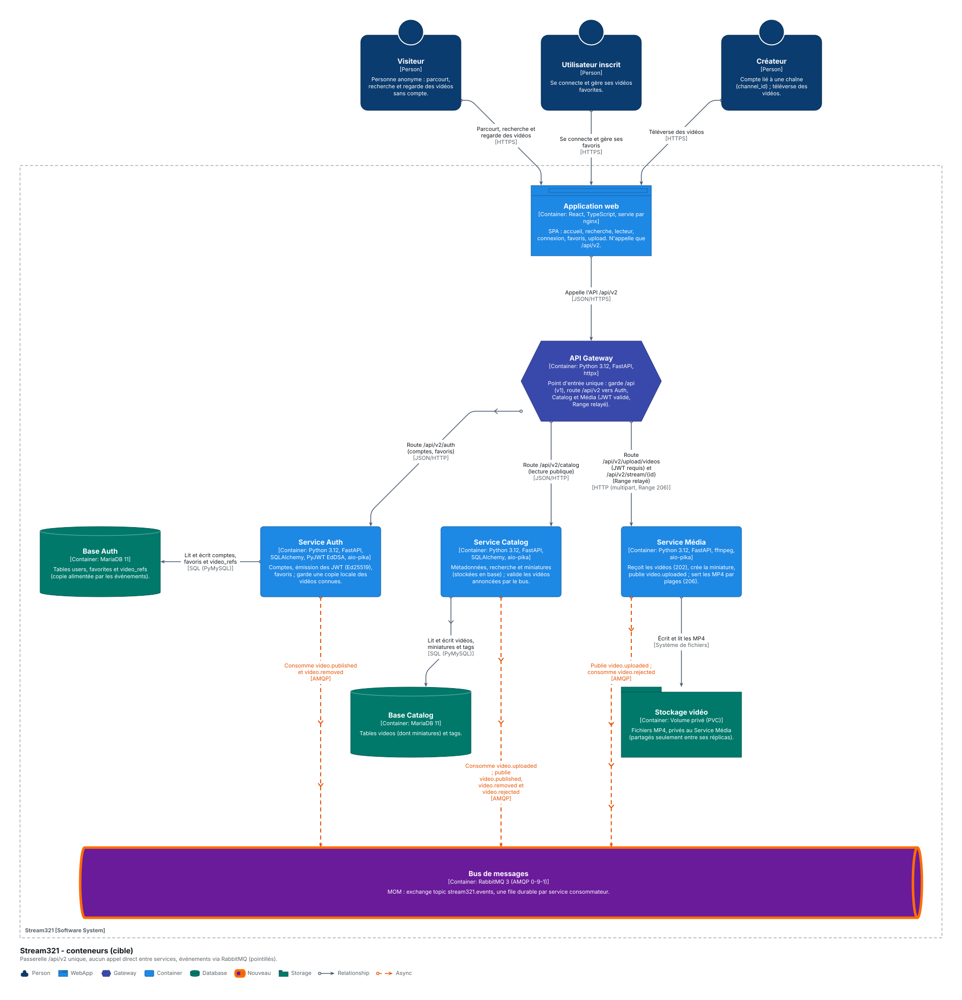
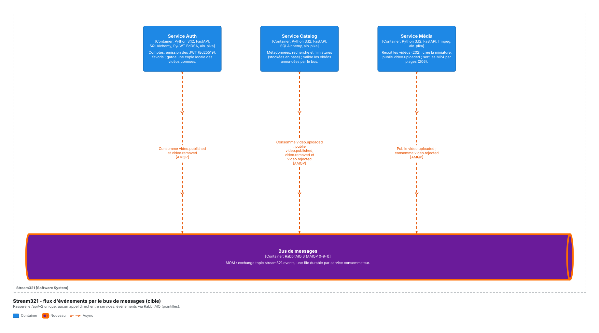
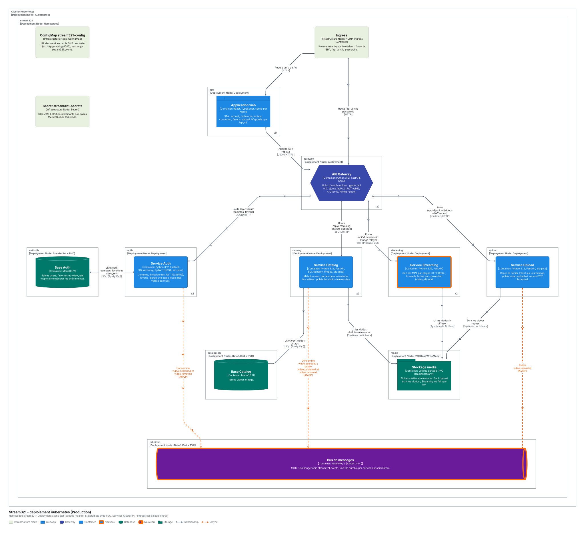

# Architecture

> **Statut : stable, contraignant.** Ce document décrit l'architecture cible de
> Stream321, décidée le 23 novembre 2026. Toute contribution, humaine ou faite
> avec un agent IA, doit s'y conformer
> (voir [`CONTRIBUTING.md`](../CONTRIBUTING.md), règle 2). Un écart se discute
> et se corrige ici d'abord, dans une PR, avant tout code.
>
> **La cible n'est pas encore le code.** L'écart entre les deux est décrit en
> [État actuel et cible](#état-actuel-et-cible). On avance vers la cible par
> les étapes de [`architecture/MIGRATION_V2.md`](architecture/MIGRATION_V2.md),
> sans jamais casser l'API v1.

Documents liés :

| Document | Contenu | Fait foi pour |
|----------|---------|---------------|
| ce fichier | Règles, composants, communication, données, déploiement | l'architecture |
| [`API_GATEWAY.md`](API_GATEWAY.md) et [`api/gateway.openapi.yaml`](api/gateway.openapi.yaml) | Routes publiques v1 et v2, codes, schémas | l'API publique |
| [`architecture/MIGRATION_V2.md`](architecture/MIGRATION_V2.md) | Comment atteindre la cible, service par service, et dans quel ordre | le détail de mise en œuvre |
| [`architecture/`](architecture/README.md) | Modèles C4 (existant et cible) et diagrammes générés | les diagrammes |

En cas de contradiction : ce fichier l'emporte sur le guide de migration et sur
les diagrammes ; pour une route publique, le fichier OpenAPI l'emporte.
`architecture-321.drawio` est un schéma antérieur : il ne fait plus foi (il
séparait Upload et Streaming, voir [Composants](#composants)).

## Vue d'ensemble

Stream321 est une plateforme de streaming vidéo miniature, construite en
microservices pour le module 321. Un visiteur parcourt le catalogue, cherche
et regarde des vidéos ; un membre garde des favoris ; un créateur envoie des
vidéos.

Trois exigences du module structurent l'architecture :

1. une architecture en microservices ;
2. une API Gateway, point d'entrée unique ;
3. un MOM (middleware orienté messages) utilisé par au moins deux
   microservices.

## Règles

Ces règles sont les décisions d'architecture. Elles s'appliquent à tout
nouveau code. Le code existant qui les enfreint est listé en
[État actuel et cible](#état-actuel-et-cible) et se corrige par la migration.

| # | Règle | Origine |
|---|-------|---------|
| R1 | **Le client n'appelle que la Gateway.** Aucune URL de microservice n'est publique. La SPA n'appelle que `/api/v2`. | cours 01, API Gateway (p.14) |
| R2 | **Aucun microservice n'appelle un autre microservice.** Pas d'appel HTTP de service à service, même pour un contrôle de santé. Les seuls appels HTTP vont du navigateur à la Gateway, puis de la Gateway à un service. | règle d'équipe, plus stricte que le cours |
| R3 | **Entre services, l'information passe par le bus de messages**, de façon asynchrone. Un service qui a besoin d'une donnée d'un autre en garde une copie locale, tenue à jour par les messages. | cours 02, MOM |
| R4 | **Chaque stockage a un seul service propriétaire.** Aucune base, aucun volume n'est lu ou monté par deux services différents. Seules les instances d'un même service partagent leur stockage. | cours 06 (p.3, p.7) |
| R5 | **Les fichiers vidéo ne passent jamais par le bus.** Un message porte des métadonnées et, au plus, une miniature JPEG de 256 ko. | décision d'équipe |
| R6 | **La v1 de l'API (`/api/*`) ne change pas.** Toute évolution se fait sous `/api/v2`. Les services ne connaissent pas la version : la Gateway retire `/v2` avant de transmettre. | cours 01, strangler pattern (p.24) |
| R7 | **La Gateway vérifie le JWT en v2** et transmet l'identité aux services par `X-User-Id` et `X-Channel-Id`. Un en-tête d'identité envoyé par le client n'atteint jamais un service. | cours 01, tâches communes de la Gateway (p.14) |
| R8 | **Pas de code partagé entre services.** Chaque service garde sa propre copie des petits modules communs (`messaging.py`), sa propre image et ses propres dépendances : il reste déployable seul. | cours 01, indépendance des services (p.10) |
| R9 | **Tout outil, dépendance ou runtime s'installe et tourne dans un conteneur Docker basé sur Ubuntu**, sans réglage propre à une machine. | [`CONTRIBUTING.md`](../CONTRIBUTING.md), règle 1 |

Ne pas ajouter : un service orchestrateur de saga, un appel HTTP entre
services « temporaire », un volume commun à deux services, une bibliothèque
Python partagée entre services, un nouveau microservice. Chacun de ces ajouts
demande d'abord une modification de ce fichier.

## Composants

Neuf conteneurs (au sens C4) forment Stream321.

| Conteneur | Rôle | Stack | Code | Port |
|-----------|------|-------|------|------|
| Application web | SPA : accueil, recherche, lecteur, connexion, favoris, envoi de vidéo | React, TypeScript, servie par nginx | `frontend/` | 80 |
| API Gateway | Point d'entrée unique. Sert `/api` (v1) et `/api/v2`, vérifie le JWT, route vers les services, transmet `Range`, diffuse les corps en flux. N'agrège pas de réponses, ne contient pas de logique métier. | Python 3.12, FastAPI, httpx | `services/gateway/` | 8000 |
| Service Auth | Comptes, émission du JWT (Ed25519), favoris. Garde `video_refs`, sa copie locale des vidéos connues. | Python 3.12, FastAPI, SQLAlchemy, PyJWT, aio-pika | `services/auth/` | 8001 |
| Base Auth | Tables `users`, `favorites`, `video_refs`, `processed_events` | MariaDB 11 | | 3306 |
| Service Catalog | Métadonnées, recherche, miniatures servies depuis sa base. N'accède à aucun fichier vidéo. | Python 3.12, FastAPI, SQLAlchemy, aio-pika | `services/catalog/` | 8002 |
| Base Catalog | Tables `videos` (miniature en colonne BLOB), `tags`, `processed_events` | MariaDB 11 | | 3306 |
| Service Média | Reçoit les envois, écrit le MP4, crée la miniature (ffmpeg), sert la lecture avec `Range` (206). | Python 3.12, FastAPI, ffmpeg, aio-pika | `services/upload/` | 8003 |
| Stockage vidéo | Fichiers `{video_id}.mp4`. Privé au Service Média. | Volume (PVC `media-videos`) | | |
| Bus de messages | Le MOM : exchange topic `stream321.events`, une queue durable par service abonné | RabbitMQ 3 (AMQP 0-9-1) | | 5672 |

Le **Service Média** est le squelette `services/upload` étendu. Il n'existe
pas de service Upload ni de service Streaming séparés : le service qui stocke
les fichiers vidéo doit être celui qui les écrit et les lit (R4). Deux
services autour des mêmes fichiers demanderaient soit un volume partagé
(interdit par R4), soit un appel direct (interdit par R2), soit des vidéos
dans le bus (interdit par R5). Le dossier garde le nom `services/upload`.

Hors périmètre : services Subtitles et Recommendation, HLS, conversion vidéo.
Ne pas les créer.

## Communication

| Chemin | Nature | Protocole |
|--------|--------|-----------|
| Navigateur → Gateway → service | synchrone | JSON sur HTTP ; multipart pour l'envoi, `Range` pour la lecture |
| Service → son propre stockage | synchrone, local | SQL (PyMySQL) ou système de fichiers |
| Service → bus → service | asynchrone | AMQP, messages JSON |

### Synchrone : la Gateway

| Préfixe v2 | Service | JWT vérifié par la Gateway |
|------------|---------|----------------------------|
| `/api/v2/auth/*` | Auth | sur `me` et `favorites` |
| `/api/v2/catalog/*` | Catalog | non |
| `/api/v2/stream/{video_id}` | Média | non |
| `/api/v2/upload/videos` | Média | oui, compte créateur |

Le contrat complet (méthodes, codes, schémas, en-têtes) est dans
[`API_GATEWAY.md`](API_GATEWAY.md). Ne pas le recopier ailleurs.

### Asynchrone : le bus de messages

| Message (clé de routage) | Publisher | Queue | Subscriber | Effet |
|--------------------------|-----------|-------|------------|-------|
| `video.uploaded` | Média | `catalog.video-uploaded` | Catalog | crée la vidéo et range sa miniature |
| `video.published` | Catalog | `auth.video-events` | Auth | met à jour `video_refs` |
| `video.removed` | Catalog | `auth.video-events` | Auth | retire la vidéo de `video_refs` et des favoris |
| `video.rejected` | Catalog | `media.video-rejected` | Média | supprime le fichier (compensation) |

- Enveloppe commune en JSON : `event_id` (UUID v4), `type`, `occurred_at`
  (ISO 8601, UTC), `data`. Le champ `type` est la clé de routage.
- Livraison au moins une fois : exchange et queues durables, messages
  persistants, confirmation côté Publisher, acquittement manuel après la
  transaction locale. **Tout Subscriber est idempotent** (table
  `processed_events`, écritures en upsert sur `video_id`).
- Chaque service déclare au démarrage l'exchange, ses queues et ses liaisons.
  L'ordre de démarrage des services n'a pas d'importance.
- Un nouveau besoin d'information entre services s'exprime par un nouveau
  message ou un nouvel abonnement, jamais par un appel HTTP.

Le contrat complet des messages (champs de `data`, garanties, cas d'erreur)
est dans [`MIGRATION_V2.md`, section 5](architecture/MIGRATION_V2.md#5-contrat-du-bus-de-messages).

### L'envoi d'une vidéo : une saga par chorégraphie

L'envoi traverse trois services sans transaction commune. Il est traité comme
une saga par chorégraphie (cours 06, p.13 à 18) : chaque service fait sa
transaction locale, puis publie un événement. **Il n'y a pas de service
orchestrateur.**

1. Média écrit le fichier, crée la miniature, publie `video.uploaded`, répond
   `202 Accepted`.
2. Catalog crée la vidéo et sa miniature dans sa base, publie
   `video.published`.
3. Auth ajoute la vidéo à `video_refs` : elle peut être mise en favori.

Échec à l'étape 2 (métadonnées, durée ou miniature invalides) : Catalog
publie `video.rejected`, Média supprime le fichier.

## Données

| Stockage | Propriétaire, seul à y accéder | Contenu |
|----------|-------------------------------|---------|
| Base Auth | Service Auth | comptes, favoris, `video_refs` |
| Base Catalog | Service Catalog | vidéos, miniatures, tags |
| Stockage vidéo | Service Média | fichiers MP4 |
| Queues RabbitMQ | le service abonné à la queue | messages en attente |

- **Source de vérité.** Le Catalog pour les métadonnées d'une vidéo, Média
  pour le fichier, Auth pour les comptes et les favoris.
- **Cohérence à terme.** `video_refs` dans Auth est une copie : une vidéo
  publiée devient ajoutable en favori après un court délai. Aucun traitement
  ne suppose un ordre global des messages entre services.
- **Le Catalog ne lit aucun fichier.** La miniature lui arrive dans
  `video.uploaded` ; il la range dans sa base et la sert lui-même.
- **Média ne demande rien au Catalog** pour servir une vidéo : le nom du
  fichier est fixé par convention, `{video_id}.mp4`.
- **Identité.** Le JWT est signé par Auth (clé privée Ed25519, algorithme
  `EdDSA`) et vérifié par la Gateway (clé publique). Les services font
  confiance aux en-têtes `X-User-Id` et `X-Channel-Id` parce que seule la
  Gateway peut les joindre.

## Déploiement

Cible : un cluster Kubernetes, namespace `stream321`. Kubernetes n'est pas un
conteneur C4 : c'est l'environnement qui héberge les neuf conteneurs.

| Objet | Nom | Remarque |
|-------|-----|----------|
| Ingress (NGINX) | `stream321` | seule entrée externe : `/api` vers `gateway`, `/` vers `spa` |
| Deployment + Service ClusterIP, 2 réplicas | `spa`, `gateway`, `auth`, `catalog`, `media` | sans état, sondes sur `/health` |
| StatefulSet + PVC + Service, 1 réplica | `auth-db`, `catalog-db`, `rabbitmq` | une base par service |
| PersistentVolumeClaim | `media-videos` | monté par le seul Deployment `media` (ReadWriteMany entre ses réplicas) |
| ConfigMap | `stream321-config` | URLs des services par DNS du cluster |
| Secret | `stream321-secrets` | clés JWT, mots de passe ; jamais versionné |

- Aucun Service n'est de type `NodePort` ou `LoadBalancer`.
- Chaque service garde son `Dockerfile` et son `docker-compose.yml`, qui
  servent à le développer seul.
- Les manifestes iront dans `k8s/` à la racine du dépôt.

Détail des manifestes : [`MIGRATION_V2.md`, section 7](architecture/MIGRATION_V2.md#7-kubernetes).

## État actuel et cible

Le code n'est pas encore à la cible. Avant de modifier un service, vérifier
ce qui existe sur la branche de travail.

| Élément | `main` | `dev` | Cible |
|---------|--------|-------|-------|
| Application web | oui, appelle le Catalog directement | idem | n'appelle que `/api/v2` |
| Service Catalog et sa base | oui, lit les fichiers vidéo | idem | ne lit aucun fichier |
| API Gateway | non | oui, v1 seulement | v1 et v2 |
| Service Auth et sa base | non | oui, sans favoris | avec favoris et `video_refs` |
| Service Média | non | squelette Upload, sans lecture | envoi et lecture |
| Bus de messages | non | non | RabbitMQ |
| Kubernetes | non | non | manifestes `k8s/` |

Écarts connus aux règles, à corriger par la migration et à ne pas reproduire :

| Écart | Où | Règle | Étape de migration |
|-------|----|-------|--------------------|
| La SPA contourne la Gateway | `frontend/vite.config.ts`, proxy `/api` vers le port 8002 | R1 | 1 |
| Upload appelle le Catalog (`GET /health`) | `services/upload/app/catalog_client.py` (sur `dev`) | R2 | 9 |
| Le Catalog lit les fichiers vidéo et crée les miniatures | `services/catalog/app/media.py` | R4 | 10 |

L'ordre des travaux est le
[plan de migration](architecture/MIGRATION_V2.md#8-plan-de-migration) : quatorze
étapes, chacune livrable seule, la v1 restant fonctionnelle après chacune.

## Limites acceptées

La cible n'est volontairement pas parfaite. Ces points sont connus et ne sont
pas à « corriger » sans décision d'équipe :

- Média cumule envoi et lecture : les deux passent à l'échelle ensemble.
- Bases et Broker en une seule instance : pas de haute disponibilité.
- La miniature voyage dans le message (JPEG réduit, 256 ko au plus).
- Volume ReadWriteMany entre les réplicas de Média, plutôt qu'un stockage
  objet.
- Le fichier d'une vidéo retirée du catalogue reste dans le Stockage vidéo.
- Pas d'observabilité, pas de NetworkPolicy, pas de conversion vidéo.

Liste complète et justifications :
[`MIGRATION_V2.md`, section 9](architecture/MIGRATION_V2.md#9-limites-acceptées-et-hors-périmètre).

## Questions ouvertes

Les règles, les composants, les messages et les routes ci-dessus sont décidés.
Restent des décisions de détail, proposées dans
[`MIGRATION_V2.md`, section 10](architecture/MIGRATION_V2.md#10-décisions-de-détail-à-valider)
et à confirmer en équipe avant l'étape qui les utilise. Les principales :

| Point | Proposition | Bloque l'étape |
|-------|-------------|----------------|
| Source du `channel_id` d'un créateur | claim `channel_id` du JWT, transmis en `X-Channel-Id` | 3, 4 |
| Contenu de `GET /api/v2/auth/favorites` | `videos` réduit à `id`, `title`, `channel_id` | 11 |
| Formulaire d'envoi | multipart `file`, `title`, `description`, `tags` ; MP4 seulement | 9 |
| Nom du dossier du Service Média | garder `services/upload` | 6 |

Tant qu'un point n'est pas confirmé, ne pas implémenter l'étape qu'il bloque.
Une décision confirmée est reportée ici et dans le guide de migration.
