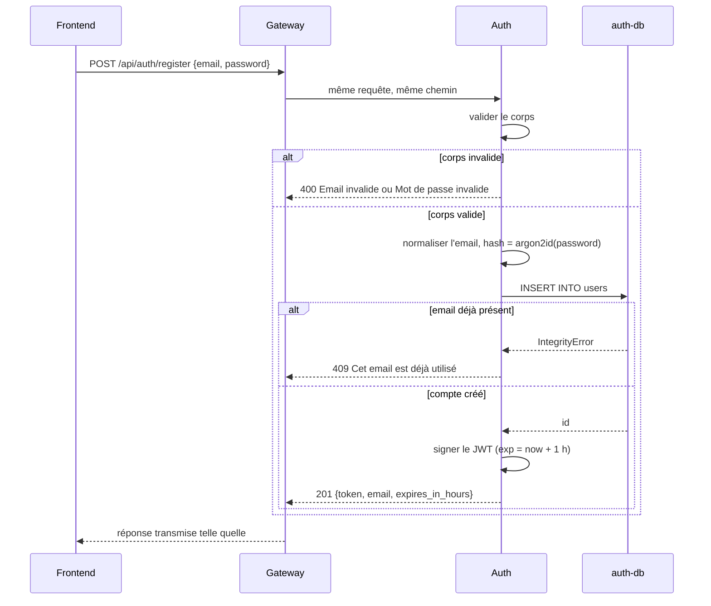
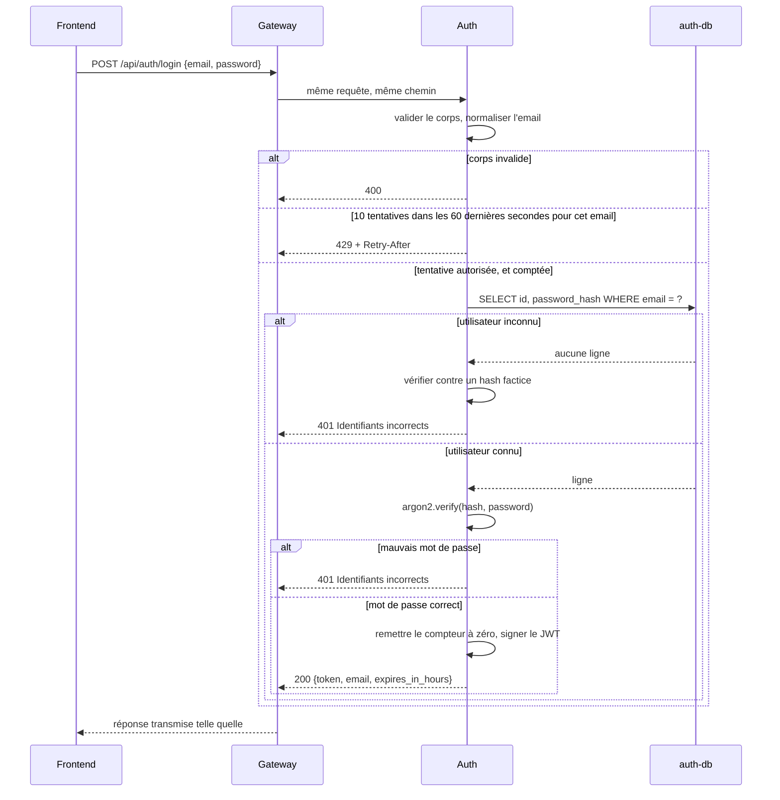
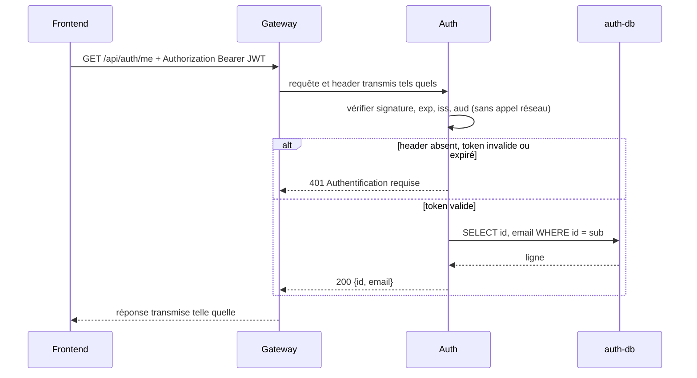
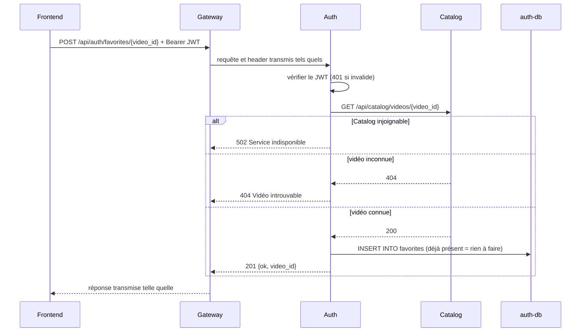
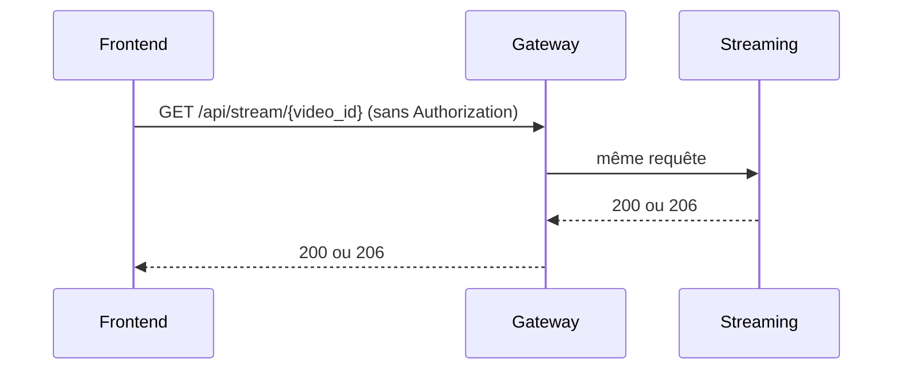

# Service d'authentification

> **Statut : proposition, implémentée dans [`services/auth/`](../services/auth/) et en
> attente de revue avec le code.** Ce document répond à
> [E0-09](https://github.com/Ovsiankina/321-distributed-app/issues/5)
> (*design authentification service*). Le code couvre
> [E1-03](https://github.com/Ovsiankina/321-distributed-app/issues/21) : inscription,
> connexion et `/me`. Les favoris restent à faire (D7).
>
> Il s'aligne sur le contrat Gateway **0.3.0**
> ([`api/gateway.openapi.yaml`](api/gateway.openapi.yaml)) : la version 0.2.0 de
> `main` (PR #34 et #35, fusionnées les 8 et 11/11/2026), plus les codes 400 et 429
> du login ajoutés par la branche `feat/auth-service` (§8).

## Historique des changements

- **13/11/2026** — Corrections après revue du code : limite de login sur une fenêtre
  glissante, comptée avant le hachage (§9) ; normalisation complète des emails et seed
  qui déplace les chaînes (§5) ; détails `404`, `405` et corps non UTF-8 en français
  (§7) ; connexion à la base rendue avant le hachage (D4) ; dépendances de test hors
  de l'image (§11).
- **13/11/2026** — Implémentation dans `services/auth/` : comptes créateurs seedés
  avec leur `channel_id` (§5), codes 400 et 429 du login ajoutés au contrat (§8),
  alignement attendu d'Upload (D2), état des dépendances mis à jour (§12).
- **30/10/2026** — Réalignement sur le contrat Gateway et sur le service Catalog :
  passage à Python et MariaDB, vérification du token par les services, favoris
  dans Auth, traduction en français.
- **25/09/2026** — Première version.

---

## 1. Périmètre

**Dans le périmètre** : tout ce qu'il faut pour répondre à *« de qui vient cette
requête ? »*

- création de compte et connexion ;
- stockage des mots de passe ;
- émission du token et son format ;
- règles de vérification du token, pour Auth et pour les autres services ;
- la base de données d'Auth ;
- les 8 comptes créateurs créés au démarrage, avec leur `channel_id` (§5) ;
- les favoris : le contrat les route vers Auth, ils sont donc conçus ici, mais
  construits après E1-03 (D7).

**Hors périmètre pour l'instant** :

- rôles et permissions ;
- OAuth et connexion sociale, vérification de l'email, réinitialisation du mot de
  passe ;
- déconnexion côté serveur et révocation (§14) ;
- le service Upload lui-même : seule sa vérification du token est décrite ici ;
- le reste de la « gestion utilisateur » du diagramme (« watch later »,
  préférences).

**Exigence héritée de la description du projet** : *visionnage sans compte*. La
navigation, la recherche et la lecture doivent fonctionner sans compte. **Auth
n'est jamais sur le chemin critique du visionnage** : s'il tombe, le catalogue, la
recherche et le lecteur fonctionnent encore, seuls la connexion et les favoris
sont dégradés. Chaque décision ci-dessous est vérifiée par rapport à cette règle.

---

## 2. Contraintes

| # | Contrainte | Source |
|---|---|---|
| C1 | Tourner dans un conteneur Docker Ubuntu, sans outillage propre à l'hôte | `CONTRIBUTING.md`, Architecture 1 |
| C2 | Conception distribuée : les services ne se bloquent pas mutuellement | `CONTRIBUTING.md`, Architecture |
| C3 | Le visionnage anonyme reste possible | Description du projet, E1-01 |
| C4 | Tests unitaires obligatoires sur la logique métier (auth, favoris) | Description du projet, Testing |
| C5 | Chaque ligne peut être défendue à l'oral par son auteur | `CONTRIBUTING.md`, AI assistance 2–3 |
| C6 | Échelle de démo : 4 développeurs, moins de 10 vidéos, pas de trafic de production | Description du projet |
| C7 | L'API respecte strictement le contrat. En cas d'écart, le YAML fait foi | `CONTRIBUTING.md`, Architecture 3 ; `API_GATEWAY.md` |

C5 et C6 expliquent pourquoi cette conception évite les modules d'authentification
tout faits et s'arrête avant un fournisseur OAuth2 / OIDC complet : ce serait la
bonne réponse à un problème que ce projet n'a pas. C7 explique pourquoi les choix
arbitraires (noms de champs, format d'erreur, type de l'identifiant) suivent le
contrat, même quand la version précédente de ce document en proposait d'autres.

---

## 3. Décisions

Chaque décision indique ses conséquences et les alternatives écartées, pour qu'un
choix puisse être rouvert plutôt que redécouvert.

### D1 — Python 3.12, FastAPI et SQLAlchemy

**Décision.** Auth est un service Python 3.12 écrit avec FastAPI et SQLAlchemy, sur
la même base technique que Catalog.

**Pourquoi.**

- Catalog est écrit ainsi (PR #35), comme la Gateway (PR #38) et Upload (PR #37). Un
  deuxième runtime backend ajouterait du coût d'apprentissage et d'outillage, sans
  gain pour ce service.
- Le format d'erreur du contrat, `{ "detail": "..." }`, est celui que produit
  `HTTPException` dans FastAPI.
- Auth peut reprendre ce que Catalog a déjà résolu : l'organisation de `app/`, le
  Dockerfile, le Compose, et le module qui valide les réponses contre le contrat,
  désormais partagé dans `tests/contract/gateway_openapi.py`.
- `argon2-cffi` et `PyJWT[crypto]` s'installent depuis des paquets précompilés :
  l'image n'a pas besoin de compilateur (C1).

**Conséquences.**

- Image `python:3.12-slim-bookworm`, comme Catalog, sans `ffmpeg`.
- Routes en `def` et non `async def`, comme Catalog : FastAPI les exécute dans un
  pool de threads, donc un hachage Argon2 ne bloque pas les autres requêtes.
- Le contrat reste la référence : il est écrit à la main, et le schéma généré par
  FastAPI ne le remplace pas. La conformité est vérifiée par des tests (§10).

**Alternatives écartées.**

- **Node 22, TypeScript et Fastify** (version précédente de ce document) : son
  principal argument était une seule langue dans toute la stack, ce qui n'est plus
  vrai avec Catalog en Python.
- **Go** : meilleures performances et image plus petite, mais une langue de plus
  dans un projet à quatre, et C5 devient plus coûteux à tenir.
- **Un module ou fournisseur d'identité tout fait** (fastapi-users, Keycloak,
  Auth0, Supabase Auth) : E1-03 deviendrait trivial et la défense orale impossible.
  Le format du token, la vérification et le stockage des mots de passe seraient une
  boîte noire.

### D2 — JWT sans état, signé en EdDSA, vérifié par le service qui protège la route

**Décision.** L'inscription et le login renvoient un JWT signé. La Gateway ne le lit
pas : elle transmet `Authorization` tel quel. Chaque service qui expose une route
protégée vérifie le token lui-même, sans appel réseau : Auth pour `/api/auth/me` et
les favoris, Upload pour ses routes quand il existera. Catalog et Streaming ne
vérifient rien, car leurs routes sont publiques.

**Pourquoi.**

- C'est ce que dit le contrat : la Gateway est un proxy.
- Aucun service n'a besoin d'Auth pour vérifier un token : Upload continue de
  fonctionner si Auth tombe (C2).
- Le visionnage ne touche jamais un token (C3).
- Sans header d'identité ajouté par la Gateway, il n'y a rien à usurper : le risque
  qu'un client envoie lui-même ce header disparaît.

**Conséquences.**

- Un token reste valide jusqu'à son expiration, sans **révocation immédiate**. La
  durée de vie courte limite le risque (D5), et le §14 décrit la suite.
- La vérification existe à deux endroits, Auth et Upload. Elle tient en quelques
  lignes (§4).
- Upload a besoin de la clé **publique**. La clé privée ne quitte jamais Auth.
- **Upload n'est pas encore aligné.** La
  [PR #37](https://github.com/Ovsiankina/321-distributed-app/pull/37) vérifie en HS256
  avec un secret partagé (`UPLOAD_JWT_SECRET`) et sans `audience` : elle refuse les
  tokens d'Auth. Il lui faut `PyJWT[crypto]`, la clé publique à la place du secret, et
  `issuer` et `audience` dans son `jwt.decode` (§4). Son README prévoit déjà de
  s'aligner sur Auth.
- Le diagramme place « Vérification des tokens » sous Login : il doit être précisé
  (§12).

**Alternatives écartées.**

- **Vérification à la Gateway, avec des headers `X-Auth-*`** (version précédente de
  ce document) : un seul point de vérification, mais cela contredit le contrat,
  oblige la Gateway à supprimer ces headers sur chaque requête entrante, et la
  Gateway de la PR #38 est écrite comme un proxy pur.
- **Appeler Auth à chaque requête** (token opaque ou appel à `/me`) : révocation
  immédiate, mais Auth devient une dépendance synchrone d'Upload (C2).

### D3 — Auth possède sa propre base MariaDB

**Décision.** Une instance MariaDB 11 dédiée à Auth (`auth-db`). Aucun autre service
ne lit ou n'écrit ses tables.

**Pourquoi.** La base par service est la frontière classique d'un système distribué
(C2), et Catalog l'applique déjà avec `catalog-db`. Garder le même moteur laisse un
seul outil à apprendre et à exploiter, et l'image officielle est basée sur Ubuntu
(C1).

**Conséquences.** **Pas de clé étrangère entre services.** `favorites.video_id`
stocke l'identifiant Catalog comme une valeur opaque, et son existence est vérifiée
par l'API au moment de l'ajout (§7). Si une vidéo quitte le catalogue, le favori
reste stocké mais n'apparaît plus dans `videos`. C'est le prix de la frontière.

Ce choix anticipe [E0-08](https://github.com/Ovsiankina/321-distributed-app/issues/4),
qui n'a pas encore de responsable : la personne qui le prendra garde le dernier mot
(§13).

**Alternatives écartées.**

- **PostgreSQL 16** (version précédente de ce document) : la base par service le
  permet, mais cela ajoute un deuxième moteur sans gain pour deux tables simples.
- **Une base partagée avec Catalog** : plus simple dans Compose, mais cela couple
  les services par le schéma, ce que ce module cherche justement à éviter.

### D4 — Argon2id pour les mots de passe

**Décision.** Argon2id avec `argon2-cffi`, à la configuration minimale recommandée
par [OWASP](https://cheatsheetseries.owasp.org/cheatsheets/Password_Storage_Cheat_Sheet.html) :
**19 MiB de mémoire, 2 itérations, parallélisme 1**.

```python
PasswordHasher(time_cost=2, memory_cost=19456, parallelism=1)
```

**Pourquoi.** Argon2id est le premier choix d'OWASP. Il consomme beaucoup de mémoire,
ce qui le rend plus résistant au craquage sur GPU que bcrypt. La bibliothèque génère
un sel aléatoire par mot de passe et l'encode avec les paramètres dans la chaîne
stockée. `check_needs_rehash()` permettra de renforcer les paramètres plus tard sans
migration.

**Conséquences.** Une trentaine de millisecondes et 19 MiB par opération. Le pool de
threads de FastAPI est limité à 40 par défaut, donc au pire environ 760 MiB. C'est
acceptable à l'échelle de la démo (C6), et une panne mémoire d'Auth ne touche pas le
visionnage (C3). Le login lit le hash puis rend sa connexion au pool SQLAlchemy avant
de hacher : des logins simultanés n'immobilisent pas les connexions dont `/me` et
l'inscription ont besoin.

**Alternative écartée.** bcrypt : acceptable et très répandu, mais limité à 72 octets
et moins résistant au GPU. Rien ne justifie de le préférer ici.

### D5 — Un seul token d'accès, valable 1 heure, sans refresh token

**Décision.** Un **unique token d'accès, valable 1 heure**. Pas de refresh token, pas
de table de sessions. La réponse porte `expires_in_hours: 1`.

**Pourquoi.** [E1-03](https://github.com/Ovsiankina/321-distributed-app/issues/21)
demande une inscription, un login et un token, rien de plus, et `CONTRIBUTING.md` est
explicite : *« If it is not needed now, it does not ship. »* Un refresh token double
les endpoints et ajoute une table et une rotation. Comme un token volé ne peut pas
être révoqué, sa durée de vie est la seule limite au risque : elle reste courte.

**Conséquences.** L'utilisateur se reconnecte après une heure. La lecture d'une vidéo
n'est pas touchée, puisqu'elle est anonyme. La valeur est réglable par
`AUTH_TOKEN_TTL_HOURS`. Les exemples du contrat indiquent 24 et doivent être alignés
(§8).

**Alternative écartée.** 24 heures, comme dans les exemples du contrat : moins de
reconnexions, mais un token volé resterait valable une journée, sans moyen de le
révoquer.

### D6 — Transport : `Authorization: Bearer`

**Décision.** Le client envoie `Authorization: Bearer <jwt>` sur les routes protégées,
comme l'exigent E1-03 et le contrat.

**Conséquence.** Le frontend garde le token dans un stockage accessible en
JavaScript, donc **exposé au XSS**, contrairement à un cookie `httpOnly`. Ce risque
est assumé et limité par la durée de vie d'une heure, l'absence de scripts tiers et
une CSP. Le passage à un cookie demanderait de modifier E1-03 et le contrat.

### D7 — Favoris dans Auth, construits après E1-03

**Décision.** Les favoris suivent le contrat : `/api/auth/favorites*` est servi par
Auth, et la table `favorites` vit dans `auth-db`. Ils sont conçus ici, mais
implémentés dans une story P2 distincte, après E1-03.

**Pourquoi.** Le contrat (`x-proxied-to: auth`) et
`tests/integration/test_auth_catalog.py` les placent déjà dans Auth. Créer un service
de plus pour une seule table coûterait plus cher qu'il ne rapporte (C6). Séparer la
livraison garde E1-03 petit : les favoris sont P2 et absents de ses critères
d'acceptation.

**Conséquences.**

- Auth dépend de Catalog **pour les favoris uniquement** : l'ajout vérifie que la
  vidéo existe, la liste récupère ses métadonnées. L'inscription, le login et `/me`
  n'en dépendent pas.
- La dépendance va dans un seul sens : Catalog n'appelle jamais Auth, il n'y a donc
  pas de blocage mutuel (C2).
- Le diagramme place les favoris dans « Gestion utilisateur », et Recommandation les
  y lit. Ce point est à trancher (§13).

**Alternatives écartées.**

- **Un service « Gestion utilisateur »**, comme dans le diagramme : un service et une
  base de plus, et des chemins du contrat à changer.
- **Dans Catalog** (version précédente de ce document) : Catalog ne valide aucun JWT,
  et il faudrait l'y introduire.

---

## 4. Contrat d'identité

*C'est la section dont les autres services dépendent. Elle a vocation à rejoindre
`ARCHITECTURE.md`.*

### Format du token

Un JWT signé, `alg: EdDSA` avec Ed25519. Pour le client, il reste une chaîne opaque
à renvoyer telle quelle. L'exemple du contrat porte un en-tête HS256 : ce n'est qu'un
exemple, seul ce document définit l'algorithme (E1-03 renvoie à E0-09 pour le format).

**En-tête**

```json
{ "alg": "EdDSA", "typ": "JWT" }
```

**Payload**

| Claim | Type | Exemple | Sens |
|---|---|---|---|
| `iss` | string | `"stream321-auth"` | Émetteur, vérifié |
| `sub` | string | `"42"` | L'`id` de l'utilisateur, en chaîne. **Seul identifiant utilisateur que les autres services stockent** |
| `aud` | string | `"stream321-api"` | Audience, vérifiée |
| `iat` | number | `1793367032` | Date d'émission |
| `exp` | number | `1793370632` | Expiration, `iat + 3600` |

`sub` est une **chaîne** alors que `id` est un entier dans le contrat. La norme JWT le
demande, et PyJWT rejette un `sub` entier à la vérification (`Subject must be a
string`). L'émission utilise donc `str(user.id)`, la lecture `int(claims["sub"])`.

**Pourquoi Ed25519 et pas HS256.** Avec un secret partagé, tout service capable de
vérifier un token pourrait aussi en fabriquer. Avec une signature asymétrique, Upload
vérifie mais ne peut rien émettre.

**Pourquoi ces seuls claims.** Un claim sans lecteur n'a pas sa place dans le token :
`email` est déjà renvoyé par le login et `/me`, il n'y a qu'un seul rôle, et `jti` et
`kid` ne servent qu'à la révocation et à la rotation (§14). Les ajouter plus tard ne
casse rien, car les vérificateurs ignorent les claims inconnus.

### Vérification

Tout service qui protège une route applique exactement ceci :

```python
claims = jwt.decode(
    token,
    public_key_pem,
    algorithms=["EdDSA"],
    issuer="stream321-auth",
    audience="stream321-api",
    leeway=30,
    options={"require": ["exp", "iat", "sub", "iss", "aud"]},
)
user_id = int(claims["sub"])
```

- `algorithms=["EdDSA"]` est **obligatoire** : c'est ce qui rejette `alg: none` et les
  tokens HS256.
- `leeway=30` tolère 30 secondes de décalage d'horloge entre conteneurs.
- Toutes les erreurs héritent de `jwt.InvalidTokenError`. Header absent, token invalide
  ou expiré : la réponse est toujours `401` avec `Authentification requise`.
- Il faut `PyJWT[crypto]` : EdDSA passe par `cryptography`. Sans `issuer` ni
  `audience`, PyJWT refuse le token, qui porte un claim `aud`.

### Clés

Auth reçoit la clé privée par `AUTH_JWT_PRIVATE_KEY`. Upload recevra la clé publique
par une variable à lui, aujourd'hui `UPLOAD_JWT_SECRET`, à renommer par exemple en
`UPLOAD_JWT_PUBLIC_KEY`. Il n'y a pas d'endpoint JWKS : un seul service en a besoin,
et une variable d'environnement suffit à cette échelle.

**Rotation** : générer une nouvelle paire et redémarrer Auth et Upload. Les tokens en
cours deviennent invalides et les utilisateurs se reconnectent. C'est acceptable à
l'échelle de la démo (C6), et le §14 décrit la rotation sans coupure.

### Requêtes anonymes

Les routes publiques ne regardent pas `Authorization`. Une requête sans token est un
état normal pour la navigation, la recherche et la lecture (C3).

---

## 5. Modèle de données

Tables possédées par Auth uniquement (D3), créées au démarrage par
`Base.metadata.create_all`, comme Catalog. Alembic reste une évolution possible.

```sql
CREATE TABLE users (
    id            INTEGER      NOT NULL AUTO_INCREMENT,
    email         VARCHAR(255) COLLATE utf8mb4_bin NOT NULL,
    password_hash VARCHAR(255) NOT NULL,
    channel_id    VARCHAR(64)  COLLATE utf8mb4_bin,  -- videos.channel_id de Catalog, sans clé étrangère (D3)
    created_at    DATETIME     NOT NULL DEFAULT now(),
    PRIMARY KEY (id),
    UNIQUE (email),
    UNIQUE (channel_id)
);

-- Story favoris, pas E1-03.
CREATE TABLE favorites (
    user_id    INTEGER     NOT NULL,
    video_id   VARCHAR(64) NOT NULL,  -- videos.id de Catalog, sans clé étrangère (D3)
    created_at DATETIME    NOT NULL DEFAULT now(),
    PRIMARY KEY (user_id, video_id),
    FOREIGN KEY (user_id) REFERENCES users (id) ON DELETE CASCADE
);
```

Notes :

- **`id` est un entier** parce que le contrat le fixe (`User.id`). Un entier séquentiel
  laisse deviner le nombre de comptes, mais `id` n'est renvoyé qu'à son propriétaire
  par `/me`. Le risque est accepté à l'échelle de la démo (C6).
- `password_hash` contient la chaîne PHC complète, 97 caractères avec ces paramètres :
  `$argon2id$v=19$m=19456,t=2,p=1$<sel>$<hash>`.
- **L'email est normalisé dans le code** avant d'être stocké ou comparé, par la même
  fonction à l'inscription, au login et au seed : `strip().lower()`, puis la forme
  normalisée d'`email-validator` (domaine IDNA/UTS-46, partie locale en NFC).
  `Alice@x.ch`, `alice@ｘ.ch` (pleine chasse) et un `é` composé ou décomposé donnent
  chacun un seul compte. Une adresse que `email-validator` refuse, comme les `.local`
  des créateurs, garde le seul `strip().lower()`.
- **Collation binaire** (`utf8mb4_bin`) sur `email` et `channel_id`. Par défaut,
  MariaDB compare sans tenir compte de la casse et, selon la collation, des accents ;
  SQLite compare octet par octet. Avec la normalisation dans le code, l'égalité est la
  même sur MariaDB et sur le SQLite des tests.
- `UNIQUE (email)` tranche les doublons. L'inscription fait un `INSERT` et traduit
  `IntegrityError` en `409`, sans `SELECT` préalable : deux inscriptions simultanées
  ne peuvent pas passer toutes les deux.
- **`channel_id`** est la clé d'appartenance d'un créateur : même valeur et même type
  que `videos.channel_id` dans Catalog. `NULL` pour les comptes créés par
  l'inscription. `UNIQUE` : un compte par chaîne. Auth ne stocke pas la liste des
  vidéos.
- Pas de `display_name`, `role` ni `updated_at` : le contrat ne les expose pas et rien
  ne les utilise. Pas de table `videos` ni `sessions` (D3, D5).

### Comptes créateurs

Au démarrage, Auth crée les comptes de
[`services/auth/fixtures/users.json`](../services/auth/fixtures/users.json), dérivé de
`poc-gateway/content/youtube/users.json` : 8 créateurs, un par chaîne, avec un mot de
passe commun (`default_password`).

- Un compte absent est créé, avec un hachage par compte : chaque sel est différent.
- Un compte existant garde son mot de passe et reprend le `channel_id` du fichier.
- Le fichier fait foi pour les chaînes qu'il liste. Une chaîne tenue par un autre
  compte lui est d'abord retirée, ce qui permet de renommer un créateur ou d'échanger
  deux chaînes sans violer `UNIQUE (channel_id)`.
- Deux écritures d'un même email ne font qu'un compte. Un email avec deux chaînes, ou
  une chaîne pour deux emails, arrête le démarrage avec un message qui les nomme.
- Aucun compte n'est supprimé, y compris ceux créés par l'inscription.
- Les adresses sont en `@stream321.local`, un domaine réservé que l'inscription refuse :
  personne ne peut s'inscrire avec l'adresse d'un créateur. Le login, lui, ne contrôle
  pas le format de l'email (§7).
- Sept chaînes possèdent les 10 vidéos du catalogue seedé. La huitième,
  `UCENv8pH4LkzvuSV_qHIcslg` (C'est pas sorcier), n'en a encore aucune.

Le mot de passe commun est publié dans le dépôt : ces comptes servent à la démo, pas à
la production. Le seed suppose un seul worker uvicorn, comme dans le Dockerfile : deux
workers pourraient insérer le même compte au premier démarrage.

---

## 6. Flux

La Gateway transmet les requêtes et les réponses sans les modifier. Elle ne produit
elle-même qu'un `502` si Auth est injoignable.

### Inscription



L'inscription renvoie un token, comme le login. Les deux passent par la même fonction
d'émission : il n'y a qu'un seul endroit où se tromper.

### Connexion



Les deux échecs renvoient le **même** corps et le même statut. La vérification contre
un hash factice leur donne aussi la même *durée* : sans elle, un email inconnu répond
nettement plus vite, et le login révèle quels comptes existent.

### Route protégée



Upload suivra le même schéma, avec la clé publique et sans lecture dans `auth-db`.

### Ajout d'un favori (story favoris)



`GET /api/auth/favorites` lit les `video_ids` dans `auth-db`, appelle une fois
`GET /api/catalog/videos` et garde les vidéos concernées. Sans favori, il répond sans
appeler Catalog. Si Catalog est injoignable : `502 Service indisponible`.

`DELETE /api/auth/favorites/{video_id}` n'appelle pas Catalog et répond `204`, que le
favori ait existé ou non.

Auth appelle Catalog directement sur le réseau interne, avec un délai court (2 s) pour
qu'un Catalog lent n'occupe pas les threads d'Auth.

### Requête anonyme



Ni token, ni Auth, ni `auth-db` : C3 est satisfaite par construction.

---

## 7. API

Les schémas et les exemples vivent dans
[`api/gateway.openapi.yaml`](api/gateway.openapi.yaml) et ne sont pas recopiés ici.
Cette section précise seulement ce que le contrat laisse à l'implémentation.

| Méthode | Chemin | `operationId` | JWT | Codes |
|---|---|---|---|---|
| POST | `/api/auth/register` | `register` | non | 201, 400, 409, 502 |
| POST | `/api/auth/login` | `login` | non | 200, 400, 401, 429, 502 |
| GET | `/api/auth/me` | `getMe` | oui | 200, 401, 502 |
| GET | `/api/auth/favorites` | `listFavorites` | oui | 200, 401, 502 |
| POST | `/api/auth/favorites/{video_id}` | `addFavorite` | oui | 201, 401, 404, 502 |
| DELETE | `/api/auth/favorites/{video_id}` | `removeFavorite` | oui | 204, 401, 502 |

Le `502` vient de la Gateway. Les `400` et `429` du login sont ajoutés au contrat par
cette branche (§8). Les routes des favoris ne sont pas encore servies : Auth y répond
`404 Route inconnue` jusqu'à la story favoris.

- Auth sert les **chemins complets** `/api/auth/*`, comme Catalog sert
  `/api/catalog/*` : la Gateway ne réécrit pas le chemin, et les tests d'intégration
  appellent ces chemins directement.
- `GET /health` répond `{ "status": "ok", "service": "auth" }`, comme Catalog. Il sert
  au healthcheck du conteneur et n'est pas routé par la Gateway.

### Règles de validation

| Champ | Règle |
|---|---|
| `email` à l'inscription | format email, 5 à 255 caractères ; les domaines réservés comme `.local` sont refusés |
| `email` au login | chaîne de 255 caractères au plus, sans contrôle de format : les créateurs seedés sont en `.local` |
| `password` à l'inscription | 6 à 128 caractères, sans règle de composition |
| `password` au login | chaîne de 128 caractères au plus |
| corps | aucun champ supplémentaire (`additionalProperties: false`, soit `extra="forbid"`) |

Le minimum de 6 vient du contrat. Il est en dessous de
[NIST SP 800-63B-4](https://pages.nist.gov/800-63-4/sp800-63b.html), qui demande
15 caractères pour un mot de passe utilisé seul : c'est un compromis accepté à
l'échelle de la démo (C6). L'absence de règle de composition, elle, suit NIST.

### Messages d'erreur

Toutes les erreurs ont la forme `{ "detail": "<message>" }`, en français. Le frontend
peut afficher `detail` tel quel et traite tout `401` hors login comme une demande de
reconnexion.

| Statut | `detail` | Cas |
|---|---|---|
| 400 | `Email invalide` | Champ `email` invalide |
| 400 | `Mot de passe invalide` | Champ `password` invalide ou absent |
| 400 | `Requête invalide` | JSON illisible ou champ inconnu |
| 401 | `Identifiants incorrects` | Login : email inconnu ou mauvais mot de passe |
| 401 | `Authentification requise` | Header absent, token invalide ou expiré |
| 404 | `Route inconnue` | Chemin qu'Auth ne sert pas, dont les favoris pour l'instant |
| 404 | `Vidéo introuvable` | Favori sur une vidéo absente du catalogue |
| 405 | `Méthode non autorisée` | Méthode non servie sur un chemin connu, avec `Allow` |
| 409 | `Cet email est déjà utilisé` | Inscription |
| 429 | `Trop de tentatives, réessayez plus tard` | Login, avec `Retry-After` |
| 502 | `Service indisponible` | Favoris, Catalog injoignable depuis Auth |

Les traces et les erreurs SQL vont dans les logs, jamais dans la réponse.

### Pièges de mise en œuvre

Ils feraient échouer le contrat ou les tests existants. Le code les traite, et des tests
le vérifient (§10) :

1. **FastAPI répond `422` avec une liste** sur un corps invalide. Le contrat veut `400`
   avec une chaîne : il faut un handler `RequestValidationError` qui choisit le message
   selon le champ en erreur.
2. **`EmailStr` refuse les adresses en `.test`**, et
   `tests/integration/http_env.py` inscrit justement `...@example.test`. Il faut
   valider avec `validate_email(value, check_deliverability=False,
   test_environment=True)`.
3. **`sub` doit être une chaîne** (§4).
4. **Ne pas recopier le `CORSMiddleware` de Catalog.** Le navigateur ne parle qu'à la
   Gateway, Auth n'a pas besoin de CORS.
5. **Starlette et FastAPI écrivent certains `detail` eux-mêmes, en anglais** :
   `Not Found`, `Method Not Allowed`, et `There was an error parsing the body` pour un
   corps JSON qui n'est pas de l'UTF-8 valide. Un handler `HTTPException` les traduit
   (`Route inconnue`, `Méthode non autorisée`, `Requête invalide`) et laisse passer
   tels quels les `detail` levés par les routes.

### Côté frontend

- `expires_in_hours` permet de prévoir la reconnexion sans décoder le token.
- Le contrat n'a pas de nom d'affichage : le bouton « account » montre l'email.
- Un échec de `GET /api/auth/me` (`401` ou `502`) ne doit jamais bloquer une page :
  l'utilisateur est simplement traité comme anonyme (C3).
- Le frontend de la [PR #36](https://github.com/Ovsiankina/321-distributed-app/pull/36)
  appelle déjà ces routes. Ses commentaires supposent encore des tokens de 24 h : avec
  1 h, la gestion des `401` demandée dans sa revue compte d'autant plus.

---

## 8. Modifications du contrat

La version 0.2.0 est fusionnée sans les codes que ce document proposait pour le login.
La branche `feat/auth-service` les ajoute, et le contrat passe en **0.3.0**. Tout le
reste est adopté tel quel. Ces changements touchent un endpoint : la review de Dmytro
est obligatoire ([`api/README.md`](api/README.md)). S'ils sont refusés, ils sont retirés
du code avant la fusion.

| # | Endroit | Modification | Pourquoi |
|---|---|---|---|
| 1 | `POST /api/auth/login` | Ajout de `400` avec `ErrorDetail` | Le contrat ne définissait aucune réponse pour un corps mal formé, par exemple sans `password` |
| 2 | `POST /api/auth/login` | Ajout de `429` avec `ErrorDetail` et `Retry-After` | Sans cela, rien ne limite les essais de mot de passe (§9) |
| 3 | `TokenResponse`, exemples de `register` et `login` | `expires_in_hours` : 24 devient 1 | D5. Le schéma acceptait déjà 1, seuls les exemples changent |
| 4 | `docs/API_GATEWAY.md`, Points d'entrée et Erreurs | Ajout des codes 400 et 429 du login, et des messages `Mot de passe invalide`, `Requête invalide` et `Trop de tentatives, réessayez plus tard` | Garder ce fichier aligné dans la même PR |

---

## 9. Sécurité

| Menace | Mesure |
|---|---|
| Fuite de la base | Argon2id, 19 MiB, t=2, p=1, sel aléatoire par mot de passe (D4) |
| Énumération par le login | Corps, statut et durée identiques pour un email inconnu et un mauvais mot de passe (§6) |
| Énumération par l'inscription | Acceptée : E1-03 et le contrat demandent `Cet email est déjà utilisé` |
| Force brute | 10 tentatives par email sur toute fenêtre glissante de 60 s, puis `429` et `Retry-After` |
| Épuisement mémoire par Argon2 | Pool de 40 threads, environ 760 MiB au pire. Accepté (D4) |
| Fabrication de token | Ed25519 : Upload vérifie mais ne peut pas émettre (D2) |
| Confusion d'algorithme | `algorithms=["EdDSA"]` imposé, `alg: none` et HS256 rejetés (§4) |
| Token volé | Durée de vie d'une heure (D5). Pas de révocation avant la Phase 2 (§14) |
| XSS volant le token | Durée de vie courte, pas de scripts tiers, CSP (D6) |
| Fuite de secret | Clé privée et mot de passe de la base hors de git : `.env`, `secrets/` et `*.pem` sont ignorés dans `services/auth/`. Aucune valeur par défaut pour un secret. Aucun corps de requête dans les logs |
| Interception | TLS terminé à la Gateway (sujet de production), HTTP sur le réseau interne |

### Limitation des essais de connexion

La limite est **par email et non par IP**. Le contrat ne prévoit pas de transmettre
l'IP du client : Auth ne voit que celle de la Gateway, et un compteur par IP mettrait
tous les utilisateurs dans le même compteur.

- La tentative est **comptée avant le hachage**, sous le même verrou que le contrôle.
  Compter après laisserait des requêtes simultanées passer toutes le contrôle avant
  le premier échec enregistré, bien au-delà de 10 essais.
- Un succès remet le compteur à zéro : seuls les **échecs** restent comptés.
- La fenêtre est **glissante** : le compteur garde l'instant de chaque tentative, et
  une place se libère quand la plus ancienne a plus de 60 s. Une fenêtre fixe, ouverte
  au premier échec, laissait passer 19 essais en 0,1 s autour de sa fin.
  `Retry-After` donne le temps jusqu'à cette place.
- Un email inconnu compte comme un email connu : un `429` ne révèle donc pas si un
  compte existe.
- Le `429` répond sans hacher, donc sans coût mémoire.
- Le compteur vit en mémoire et supprime ses entrées expirées, pour rester borné face à
  des emails aléatoires.

Limites assumées (C6) : dix faux essais suffisent à bloquer un compte pendant 60 s ; le
compteur repart de zéro au redémarrage et ne se partage pas entre plusieurs instances ;
l'inscription n'est pas limitée.

---

## 10. Tests

Ils répondent à E1-03 (*« Tests unitaires sur l'inscription, la vérification du mot de
passe et l'émission du token »*) et à C4. Les 103 tests de
[`services/auth/tests/`](../services/auth/tests/) tournent, comme pour Catalog, sur un
SQLite temporaire, avec une clé générée à la volée. Chaque réponse JSON est validée
contre `gateway.openapi.yaml`, avec le même outil que Catalog.

| Fichier | Ce qui est vérifié |
|---|---|
| `test_passwords.py` | Bon et mauvais mot de passe, sel aléatoire, paramètres `m=19456,t=2,p=1` ; hash illisible refusé sans exception |
| `test_register.py` | `201` avec le token et jamais le hash ; `409` quelle que soit la casse, et pour un domaine en pleine chasse ou un accent décomposé ; bornes 6 et 128 ; `400` et non `422`, avec le bon message, y compris pour un corps non UTF-8 ; `@example.test` accepté, `.local` refusé |
| `test_login.py` | Créateur seedé ; email insensible à la casse ; email inconnu et mauvais mot de passe : corps **identiques octet par octet**, et hash factice bien vérifié ; corps invalides ou non UTF-8 en `400` ; hash illisible en `401` compté |
| `test_rate_limit.py` | `429` au 11ᵉ essai, sans hacher, même avec le bon mot de passe ; remise à zéro après un succès ; email inconnu compté ; 30 requêtes simultanées : exactement 10 `401` ; tentative comptée avant le hachage ; fenêtre glissante, pas de rafale à sa fin, et purge avec une horloge injectée |
| `test_errors.py` | `404 Route inconnue` et `405 Méthode non autorisée` en français ; les `detail` et headers des routes passent tels quels |
| `test_me.py` | `200` avec `{id, email}` ; `401` sans header, avec un autre schéma, et pour dix tokens invalides (expiré, autre clé, `iss` ou `aud` étranger, sans `exp`, `sub` non numérique, payload modifié, `alg: none`, HS256, illisible) ; tolérance de 30 s |
| `test_tokens.py` | Exactement `iss`, `sub`, `aud`, `iat`, `exp` ; `sub` en chaîne ; `exp - iat` ; en-tête EdDSA ; durée réglable |
| `test_seed.py` | Les 8 créateurs du vrai fichier ; normalisation ; sels distincts ; idempotence sans re-hachage ; mise à jour du `channel_id` ; chaîne déplacée vers un compte renommé, échange de deux chaînes ; deux écritures d'un email fusionnées ; fichier contradictoire refusé sans rien écrire ; aucune suppression |
| `test_config.py` | Arrêt sans base ni clé, avec une URL ou une clé illisible, une clé non Ed25519, une durée invalide ; valeurs par défaut, y compris pour une variable vide ; mot de passe de la base avec `@ : / # %` |
| `test_health.py`, `test_db_engine.py` | `503` si la base tombe ; `pool_pre_ping` et collation binaire sur MariaDB |
| `test_openapi_contract.py` | Contrat valide ; codes du contrat égaux à ceux du service |

[`unit-auth.yml`](../.github/workflows/unit-auth.yml) lance ces tests sur chaque PR qui
touche `services/auth/` ou le contrat.

**Intégration** (recommandée, pas obligatoire). `tests/integration/` s'active avec
`INTEGRATION_AUTH_URL=http://127.0.0.1:8001`. `register_and_login` de `http_env.py`
passe contre le service. `test_auth_catalog.py` échouera tant que la story favoris
n'est pas livrée, et `test_upload_auth.py` tant qu'Upload n'est pas aligné (D2).

**Story favoris**, à écrire avec elle : ajout et retrait idempotents, `404` pour une
vidéo inconnue, `502` si Catalog est injoignable sauf au retrait, vidéo sortie du
catalogue absente de `videos`, `401` sans token.

Les comportements de bibliothèques cités dans ce document ont été vérifiés le 13/11/2026
avec Python 3.12, FastAPI 0.115.6, Pydantic 2.10.3, SQLAlchemy 2.0.36, PyJWT 2.15.1,
cryptography 50.0.2, argon2-cffi 25.1.0 et email-validator 2.3.0.

---

## 11. Déploiement

*Cette section a vocation à rejoindre `ARCHITECTURE.md`, section Deployment.*

Le service suit l'organisation de Catalog. Le
[README du service](../services/auth/README.md) décrit le lancement, la génération de
la clé et les variables.

```text
services/auth/
├── Dockerfile, docker-compose.yml, .env.example, README.md
├── requirements.txt      # dépendances de l'image
├── requirements-dev.txt  # + outils de test, installés par la CI seulement
├── fixtures/users.json   # les 8 comptes créateurs (§5)
├── app/
│   ├── main.py, config.py, db.py, models.py, schemas.py
│   ├── passwords.py      # hachage, vérification, hash factice
│   ├── tokens.py         # émission et vérification du JWT
│   ├── rate_limit.py     # compteur d'échecs par email
│   ├── seed.py           # comptes créateurs
│   └── routers/auth.py
└── tests/
```

Port **8001**, à côté de la Gateway (8000), de Catalog (8002) et d'Upload (8003). Le
[Compose du service](../services/auth/docker-compose.yml) lance `auth` et `auth-db`
(MariaDB 11, mot de passe root aléatoire). Il lit `AUTH_DB_PASSWORD` et
`AUTH_JWT_PRIVATE_KEY` dans un `.env` ignoré par git, et s'arrête en nommant la variable
manquante si le fichier est incomplet. Comme les autres services, Auth publie son port
pour que la Gateway le joigne par `host.docker.internal`, en attendant un Compose
commun.

| Variable | Défaut | Notes |
|---|---|---|
| `AUTH_DATABASE_URL` | **obligatoire** | URL SQLAlchemy de `auth-db`, sans mot de passe |
| `AUTH_DB_PASSWORD` | aucun | Ajouté à l'URL sans la relire : tous les caractères sont permis |
| `AUTH_JWT_PRIVATE_KEY` | **obligatoire** | Clé privée Ed25519, PEM, générée une fois, hors de git |
| `AUTH_JWT_ISSUER`, `AUTH_JWT_AUDIENCE` | `stream321-auth`, `stream321-api` | Doivent correspondre à ce qu'attend Upload |
| `AUTH_TOKEN_TTL_HOURS` | `1` | Heures entières |
| `AUTH_FIXTURES_DIR` | `fixtures/` | Dossier de `users.json` |
| `AUTH_CATALOG_URL` | story favoris | Par exemple `http://catalog:8002` |

- Le service **valide sa configuration à l'import et s'arrête avec un code non nul**
  s'il manque une variable obligatoire. Contrairement à Catalog et Upload, aucun secret
  n'a de valeur par défaut, ni dans le code ni dans l'image.
- Les tables sont créées par `create_all` au démarrage, puis les comptes créateurs.

---

## 12. Ce que cela débloque, et ce qu'il manque

**Débloque**

- Upload : le §4 décrit ce qu'il doit vérifier, et Auth émet de vrais tokens.
- La story favoris : les §5 et §6 la décrivent, et la table `users` est en place.
- [E0-08](https://github.com/Ovsiankina/321-distributed-app/issues/4) : le §5 est la
  moitié Auth de la spécification de base de données.

**Manque pour clore E1-03** (état au 13/11/2026)

| Dépendance | État |
|---|---|
| Revue du code et de ce document (E0-09, E1-03) | Branche `feat/auth-service`, pas encore de PR |
| Modifications du contrat (§8) | Dans la même branche, review de Dmytro obligatoire |
| Proxy `/api/auth/*` dans la Gateway | Absent : la [PR #38](https://github.com/Ovsiankina/321-distributed-app/pull/38) (E0-04, port 8000) ne transmet que catalog et subtitles. **Bloquant** pour le critère « via la Gateway » d'E1-03 |
| Upload aligné sur EdDSA | [PR #37](https://github.com/Ovsiankina/321-distributed-app/pull/37) en HS256 avec un secret partagé (D2) |
| Pages de connexion et d'inscription | Dans la [PR #36](https://github.com/Ovsiankina/321-distributed-app/pull/36), changements demandés sur la gestion des `401` |
| `ARCHITECTURE.md` absorbe les §4 et §11 | Toujours un placeholder |
| Diagramme `architecture-321.drawio` | À mettre à jour : vérification des tokens, emplacement des favoris |
| Story favoris (P2) | À créer |
| E1-03 et E0-08 | Sans responsable sur GitHub |

---

## 13. Questions ouvertes pour l'équipe

1. **Favoris et diagramme.** David confirme-t-il que les favoris restent dans Auth
   plutôt que dans « Gestion utilisateur » ? Si oui, Recommandation devra les lire chez
   Auth, ce qui demandera une route interne encore non définie.
2. **Qui ajoute le proxy `/api/auth/*` à la Gateway ?** La PR #38 le laisse hors
   périmètre. Il ne demande qu'un routeur de plus, sur le modèle de celui de Catalog.
3. **`channel_id` dans le token ?** Pour rattacher une vidéo uploadée à son créateur,
   Upload aura besoin de la chaîne de l'utilisateur. Un claim `channel_id` lui éviterait
   un appel à Auth (D2). `/me` ne peut pas la renvoyer sans changer le contrat : `User`
   n'accepte que `id` et `email`. À trancher avec la story upload.
4. **Qui prend E0-08 ?** Auth et Catalog utilisent de fait MariaDB 11 : il reste à
   l'officialiser.
5. **Qui prend E1-03 et la story favoris sur GitHub ?**
6. **Refresh tokens : Sprint 2 ou jamais ?** D5 les reporte, le §14 décrit le travail.

---

## 14. Phase 2 : conçu, pas construit

Écrit pour que les raccourcis du MVP soient délibérés et non oubliés. Rien de ceci
n'arrive au Sprint 1 (D5).

- **Refresh tokens et déconnexion.** La durée de vie du token descend vers 15 minutes,
  avec un refresh token opaque, stocké haché dans `refresh_tokens` et renouvelé à chaque
  usage. Cela ajoute `POST /api/auth/refresh` et `POST /api/auth/logout`, et demande de
  **changer le contrat** : `expires_in_hours` est un entier et ne peut pas exprimer
  15 minutes.
- **Révocation avant expiration.** Ajout d'un claim `jti` et d'une liste de tokens
  révoqués. Chaque service qui vérifie (Auth, Upload) devrait la consulter : c'est le
  vrai compromis avec D2, car il faudrait un stockage partagé ou un appel à Auth.
- **Rotation sans coupure.** Ajout de `kid` et d'un `GET /.well-known/jwks.json` interne :
  la nouvelle clé est publiée à côté de l'ancienne, qui disparaît une fois ses tokens
  expirés.
- **Limitation partagée.** Si Auth tourne en plusieurs instances, le compteur passe dans
  un stockage commun. Si la Gateway transmet un jour l'IP du client, une limite par IP
  peut s'y ajouter.
- **Réinitialisation du mot de passe et vérification de l'email.** Les deux demandent
  un serveur SMTP, ce qui explique leur absence du MVP.
- **Rôles.** Une colonne `role` et un claim du même nom, si l'upload devient réservé à
  certains comptes.
