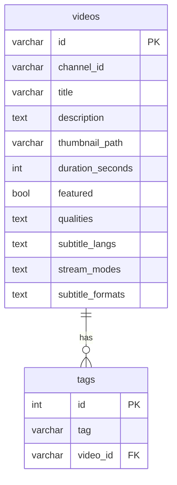

# Base de données Catalog

## Moteur et déploiement

- **Production / Docker** : **MariaDB 11** dans le conteneur `catalog-db` ([`docker-compose.yml`](../docker-compose.yml)), volume `catalog-mariadb-data`.
- **Connexion** : `CATALOG_DATABASE_URL`. En Docker le mot de passe est `CATALOG_DB_PASSWORD`, pas dans l'URL.
- **Pas de fichiers** : les vignettes JPEG sont dans `videos.thumbnail_jpeg` (voir section Vignettes).

Le microservice possède sa propre base (bloc « DB vidéo / catalogue » du schéma d'architecture), distincte des services login, favoris ou streaming.

Les tests pytest utilisent un SQLite temporaire via `CATALOG_DATABASE_URL` pour aller vite ; ce n'est pas le modèle de déploiement.

## Schéma

### Table `videos`

| Colonne | Type MariaDB | Notes |
|---------|----------------|-------|
| `id` | `VARCHAR(64)` PK | Identifiant vidéo (`catalog.json` → `id`) |
| `channel_id` | `VARCHAR(64)` | Identifiant stable du créateur / chaîne (voir Créateur) |
| `title` | `VARCHAR(512)` | |
| `description` | `TEXT` | |
| `thumbnail_path` | `VARCHAR(512)` | Inutilisé. La vignette est `thumbnail_jpeg`. |
| `thumbnail_jpeg` | `MEDIUMBLOB` | JPEG servi par la route thumbnail. Vide pour une fixture tant que `announce` ne l'a pas envoyée. |
| `duration_seconds` | `INT` | Dérivé de `duration_string` |
| `featured` | `BOOLEAN` | `fixtures/featured.json`, pas le JSON YouTube |
| `qualities` | `TEXT` | JSON array, ex. `["360p","720p"]` |
| `subtitle_langs` | `TEXT` | JSON array, lu dans le fixture (défaut `[]`) |
| `stream_modes` | `TEXT` | JSON array, ex. `["mp4"]` |
| `subtitle_formats` | `TEXT` | JSON array, ex. `["srt"]` |

Index : `channel_id` (filtres / agrégations par créateur plus tard).

### Table `tags`

| Colonne | Type | Notes |
|---------|------|-------|
| `id` | `INT` PK AUTO_INCREMENT | |
| `tag` | `VARCHAR(128)` | Index pour la recherche |
| `video_id` | `VARCHAR(64)` FK | `ON DELETE CASCADE` |
| | | UNIQUE (`tag`, `video_id`) |

**Hors MVP** : pas de table `video_chapters` (`chapter_count` / `chapters` du JSON) tant qu'il n'y a pas de story navigation par chapitres.

## Créateur (`channel_id` vs `uploader_id`)

Dans `catalog.json`, YouTube expose à la fois :

| Champ JSON | Exemple | Usage catalog |
|------------|---------|----------------|
| **`channel_id`** | `UCENv8pH4LkzvuSV_qHIcslg` | **Stocké en base** : clé stable pour regrouper les vidéos d'un même créateur. |
| `uploader_id` | `@Cestpassorcierofficiel` | Handle affichable, peut changer : **non importé** au MVP (affichage / service créateur ultérieur). |

Colonne retenue : **`videos.channel_id`**, remplie au seed depuis `catalog.json`.

## Vignettes

Une vignette par vidéo au MVP.

| Couche | Emplacement |
|--------|-------------|
| **Base** | `videos.thumbnail_jpeg`, JPEG, 256 ko au plus |
| **API publique** | `thumbnail_url` = `/api/catalog/videos/{id}/thumbnail` |

Le catalog ne génère plus de vignette. Elle arrive dans `video.uploaded` (`origin=dataset` pour le jeu de démonstration, `origin=upload` pour un envoi). Sans octet en base, la route thumbnail répond 404.

## Mapping `catalog.json` → DB

| Champ source | Destination |
|--------------|-------------|
| `id` | `videos.id` |
| `channel_id` | `videos.channel_id` |
| `title` | `videos.title` |
| `description` | `videos.description` |
| `tags` + `categories` | lignes `tags` (dédupliquées) |
| `duration_string` | `videos.duration_seconds` |
| `qualities`, `subtitle_langs` | colonnes JSON, défaut `["360p","720p"]` et `[]` si le fixture ne les donne pas |

Champs **non** importés au MVP : `channel`, `uploader_id`, `channel_follower_count`, dates, compteurs, `language`, `chapters`, `chapter_count`, `webpage_url`.

## Politique de seed

Au démarrage (`lifespan` FastAPI), `sync_catalog_on_startup` prend `GET_LOCK('catalog_sync', 30)` sur MariaDB, puis resynchronise la base. Sous SQLite (tests), il n'y a pas de verrou. Les lignes `source=upload` ne sont pas supprimées.

1. `CREATE TABLE` si besoin (`Base.metadata.create_all`).
2. Lecture `catalog.json` et `featured.json`.
3. Upsert des vidéos du fixture, remplacement de leurs tags.
4. Suppression des vidéos fixture absentes du JSON.
5. Publication `video.published` / `video.removed` si `CATALOG_AMQP_URL` est défini.

Re-lancer le service resynchronise la DB avec les fixtures.

Le pool SQLAlchemy MariaDB utilise `pool_pre_ping` : une connexion coupée par un redémarrage de `catalog-db` est écartée avant la prochaine requête. Les tests pytest restent sur SQLite, sans ce réglage.

Évolution possible : migrations versionnées (Alembic) au lieu de `create_all` seul.
